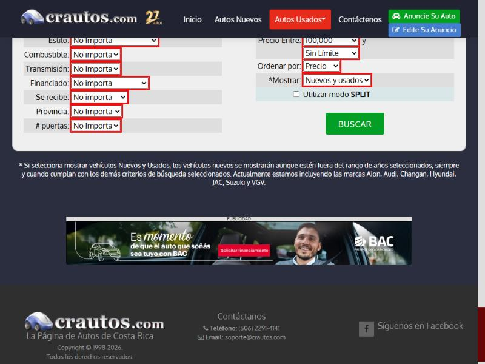

# 🐞 Reporte de Bug

## ID

BUG-006

## Título

Los 16 controles del buscador del catálogo (14 desplegables, «Modelo» y «Utilizar modo SPLIT») no tienen nombre accesible ni etiqueta

## Estado

- [x] Nuevo
- [ ] En revisión
- [ ] En desarrollo
- [ ] Resuelto
- [ ] Cerrado

## Reportado por

Gabriel Isaías Fallas López

## Fecha de detección

2026-10-04

## Prioridad

- 🔴 **Crítica** (rompe flujo principal / seguridad)

## Descripción

**Funcionalidad crítica (Tarea 2):** CT-01 — Búsqueda y listado de vehículos.

**Regla(s) de axe:** `select-name`. **Criterio WCAG:** `select-name`: 4.1.2 Nombre, función, valor (A).

**Regla(s) de axe:** `label`. **Criterio WCAG:** `label`: 4.1.2 Nombre, función, valor (A).

Página(s) donde se observó:

- Catálogo de Autos Usados: `https://crautos.com/autosusados/index.cfm` (viewport 1280×800)

## Pasos para reproducir

1. Abrir `https://crautos.com/autosusados/index.cfm` en Chromium con un viewport de 1280×800, sin iniciar sesión.
2. En la consola del navegador cargar axe-core 4.10.2 (`https://cdnjs.cloudflare.com/ajax/libs/axe-core/4.10.2/axe.min.js`) y ejecutar `await axe.run(document, {resultTypes: ['violations', 'incomplete']})` (equivale a «Scan all of my page» de Axe DevTools).
3. En `violations`, abrir la(s) regla(s) `select-name`, `label` y buscar los nodos con los selectores de la tabla de «Resultado obtenido».
4. En la consola ejecutar `document.searchform.querySelectorAll('label').length`.

## Resultado esperado

- El desplegable está asociado a un `<label for>` (o tiene `aria-label`) con el nombre del filtro.
- El campo tiene un `<label for>` con el texto «Modelo».
- La casilla está asociada con su texto «Utilizar modo SPLIT» mediante `<label for>`.

## Resultado obtenido

- Axe reportó la regla `select-name` (impacto Crítico, 4.1.2 Nombre, función, valor (A)) en el catálogo (escritorio): **14** nodo(s) en total.
- Axe reportó la regla `label` (impacto Crítico, 4.1.2 Nombre, función, valor (A)) en el catálogo (escritorio): **2** nodo(s) en total.
- Mensaje de axe: «Element does not have an implicit (wrapped) <label> / Element does not have an explicit <label>».
- Elementos agrupados (el identificador anterior es el de la versión previa de los reportes, ver «Equivalencia de IDs» del README):

| Antes | Elemento | Selector | HTML devuelto por axe | Texto visible |
|---|---|---|---|---|
| ant-013 | El desplegable «Marca» (`brand`) del buscador del catálogo no tiene nombre accesible | `select[name="brand"]` | `<select name="brand" size="1" class="col-xs-10">` | «Marca:». |
| ant-014 | El desplegable «Estilo» (`style`) del buscador del catálogo no tiene nombre accesible | `select[name="style"]` | `<select name="style" size="1" class="col-xs-10">` | «Estilo:». |
| ant-015 | El desplegable «Combustible» (`fuel`) del buscador del catálogo no tiene nombre accesible | `select[name="fuel"]` | `<select name="fuel" size="1" class="col-xs-8">` | «Combustible:». |
| ant-016 | El desplegable «Transmisión» (`trans`) del buscador del catálogo no tiene nombre accesible | `select[name="trans"]` | `<select name="trans" size="1" class="col-xs-8"> <option value="0" selected="">No Importa</option> <option v...` | «Transmisión:». |
| ant-017 | El desplegable «Financiado» (`financed`) del buscador del catálogo no tiene nombre accesible | `select[name="financed"]` | `<select name="financed" size="1" class="col-xs-10"> <option value="00" selected="">No importa</option> <opt...` | «Financiado:». |
| ant-018 | El desplegable «Se recibe» (`recibe`) del buscador del catálogo no tiene nombre accesible | `select[name="recibe"]` | `<select name="recibe" size="1" class="col-xs-10"> <option value="0" selected="">No importa</option> <option...` | «Se recibe:». |
| ant-019 | El desplegable «Provincia» (`province`) del buscador del catálogo no tiene nombre accesible | `select[name="province"]` | `<select name="province" size="1" class="col-xs-7">` | «Provincia:». |
| ant-020 | El desplegable «# puertas» (`doors`) del buscador del catálogo no tiene nombre accesible | `select[name="doors"]` | `<select name="doors" size="1" class="col-xs-7"> <option value="0" selected="">No Importa</option> <option v...` | «# puertas:». |
| ant-021 | El desplegable «Año Entre (valor inicial)» (`yearfrom`) del buscador del catálogo no tiene nombre accesible | `select[name="yearfrom"]` | `<select name="yearfrom" size="1" class="col-xs-5">` | «Año Entre:». |
| ant-022 | El desplegable «Año Entre … y (valor final)» (`yearto`) del buscador del catálogo no tiene nombre accesible | `select[name="yearto"]` | `<select name="yearto" size="1" class="col-xs-5">` | - |
| ant-023 | El desplegable «Precio Entre (valor inicial)» (`pricefrom`) del buscador del catálogo no tiene nombre accesible | `select[name="pricefrom"]` | `<select name="pricefrom" size="1" class="col-xs-7">` | «Precio Entre:». |
| ant-024 | El desplegable «Precio Entre … y (valor final)» (`priceto`) del buscador del catálogo no tiene nombre accesible | `select[name="priceto"]` | `<select name="priceto" size="1" class="col-xs-7">` | - |
| ant-025 | El desplegable «Ordenar por» (`orderby`) del buscador del catálogo no tiene nombre accesible | `select[name="orderby"]` | `<select name="orderby" class="col-xs-5">` | «Ordenar por:». |
| ant-026 | El desplegable «Mostrar (nuevos / usados)» (`newused`) del buscador del catálogo no tiene nombre accesible | `select[name="newused"]` | `<select name="newused" size="1" class="col-xs-8"> <option value="0" selected="">Solo usados</option> <optio...` | «*Mostrar:». |
| ant-027 | El campo de texto «Modelo» del buscador no tiene etiqueta asociada | `input[name="modelstr"]` | `<input name="modelstr" type="text" value="" size="30" maxlength="30">` | - |
| ant-028 | La casilla «Utilizar modo SPLIT» del buscador no tiene etiqueta asociada | `input[type="checkbox"]` | `<input type="checkbox" name="splitmode" value="1">` | - |

- Inspección manual: `document.searchform.querySelectorAll('label').length` devolvió **0**.

## Evidencia

- Resultado crudo de axe: [`evidencia/axe/catalogo.jsonl`](../evidencia/axe/catalogo.jsonl) (buscar la regla indicada).
- Inspección manual: [`evidencia/inspeccion-manual.md`](../evidencia/inspeccion-manual.md#rótulos-visibles-junto-a-cada-control-leídos-del-dom).
- Captura del formulario (con un borde rojo que **yo añadí por consola** para marcar los controles; no forma parte del sitio): 

## Entorno de pruebas

- Navegador: Chromium 152 (navegador integrado de la app Claude para escritorio)
- Herramienta: axe-core 4.10.2 (motor de Axe DevTools)
- Dispositivo: Escritorio (viewport emulado 1280×800)
- Sistema operativo: Windows 11 Pro
- URL: `https://crautos.com/autosusados/index.cfm`

## Notas adicionales

- Es el control cuyo orden por Año ya falló funcionalmente en la Tarea 2 (CT-BUS-004).
- Reemplaza a los reportes individuales ant-013, ant-014, ant-015, ant-016, ant-017, ant-018, ant-019, ant-020, ant-021, ant-022, ant-023, ant-024, ant-025, ant-026, ant-027, ant-028 de la versión anterior (113 reportes) (ver «Equivalencia de IDs» en el [README](../README.md#equivalencia-de-ids)). La prioridad del grupo es la más alta de sus elementos.
- Prioridad individual de los elementos: ant-013 Crítica; ant-014 Alta; ant-015 Alta; ant-016 Alta; ant-017 Alta; ant-018 Media; ant-019 Alta; ant-020 Media; ant-021 Alta; ant-022 Alta; ant-023 Alta; ant-024 Alta; ant-025 Media; ant-026 Media; ant-027 Alta; ant-028 Media.

Referencias de las reglas de axe:

  - `select-name`: https://dequeuniversity.com/rules/axe/4.10/select-name
  - `label`: https://dequeuniversity.com/rules/axe/4.10/label
