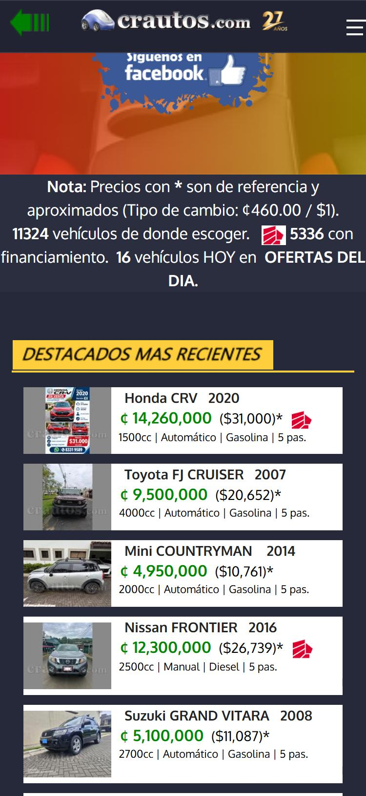

# 🐞 Reporte de Bug

## ID

BUG-006

## Título

El precio de las tarjetas (verde `#008800` sobre gris `#efefef`) no alcanza el contraste mínimo en el catálogo y en los resultados

## Estado

- [x] Nuevo
- [ ] En revisión
- [ ] En desarrollo
- [ ] Resuelto
- [ ] Cerrado

## Reportado por

Gabriel Isaías Fallas López

## Fecha de detección

2026-10-04

## Prioridad

- 🟡 **Media** (molesta, pero tiene solución temporal)

## Descripción

**Funcionalidad crítica (Tarea 2):** CT-01 — Búsqueda y listado de vehículos.

**Regla(s) de axe:** `color-contrast`. **Criterio WCAG:** `color-contrast`: 1.4.3 Contraste mínimo (AA).

Página(s) donde se observó:

- Catálogo de Autos Usados: `https://crautos.com/autosusados/index.cfm` (viewport 1280×800)
- Resultados de búsqueda: `https://crautos.com/autosusados/searchresults.cfm?p=1&c=10040` (viewport 1280×800)

## Pasos para reproducir

1. Abrir `https://crautos.com/autosusados/index.cfm` en Chromium con un viewport de 1280×800, sin iniciar sesión.
2. En la consola del navegador cargar axe-core 4.10.2 (`https://cdnjs.cloudflare.com/ajax/libs/axe-core/4.10.2/axe.min.js`) y ejecutar `await axe.run(document, {resultTypes: ['violations', 'incomplete']})` (equivale a «Scan all of my page» de Axe DevTools).
3. En `violations`, abrir la regla `color-contrast` y buscar el nodo con selector `td.precio`.
4. Repetir en los resultados de búsqueda.

## Resultado esperado

- El precio alcanza al menos 4,5:1 (por ejemplo un verde más oscuro).

## Resultado obtenido

- Axe reportó `color-contrast` (impacto Serio, 1.4.3 Contraste mínimo (AA)) con estas mediciones:

| Elemento | Texto | Fondo | Tamaño | Contraste | Mínimo |
|---|---|---|---|---:|---:|
| `td.precio` / `span.precio` (precio en colones) | #008800 | #efefef | 16 px (12 pt) o 18 px en resultados | **4,03:1** | 4,5:1 |

## Evidencia

- Resultado crudo de axe: [`evidencia/axe/catalogo.jsonl`](../evidencia/axe/catalogo.jsonl) (buscar la regla indicada). Nodos: 44 + 10 + 8 = 62 precios en el catálogo.
- Resultado crudo de axe: [`evidencia/axe/resultados.jsonl`](../evidencia/axe/resultados.jsonl) (buscar la regla indicada). Nodos: 3 + 12 + 4 = 19 precios en los resultados.
- Captura de los precios en verde sobre fondo claro (vista móvil): 

## Entorno de pruebas

- Navegador: Chromium 152 (navegador integrado de la app Claude para escritorio)
- Herramienta: axe-core 4.10.2 (motor de Axe DevTools)
- Dispositivo: Escritorio (viewport emulado 1280×800)
- Sistema operativo: Windows 11 Pro
- URL: `https://crautos.com/autosusados/index.cfm`, `https://crautos.com/autosusados/searchresults.cfm?p=1&c=10040`

## Notas adicionales

- Mismo color de texto y fondo en ambos listados: 4,03:1 (tarjetas de 16 px) y 4,03:1 (18 px en el layout de resultados).

Referencias de las reglas de axe:

  - `color-contrast`: https://dequeuniversity.com/rules/axe/4.10/color-contrast
