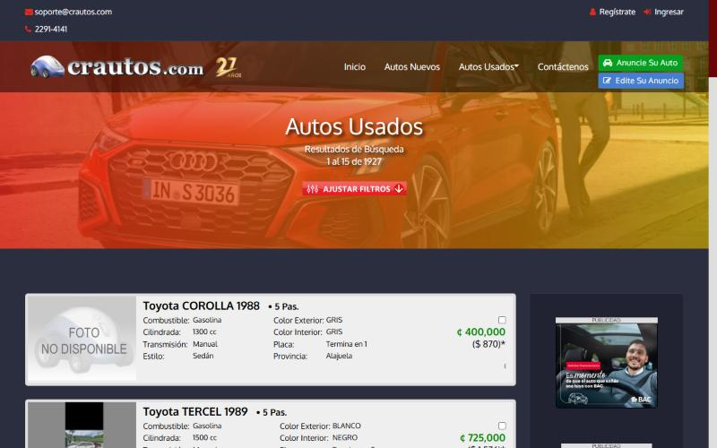

# 🐞 Reporte de Bug

## ID

BUG-007

## Título

Las 16 casillas de las tarjetas de los resultados (15 de comparación `name="c"` y la casilla de ejemplo `demo`) no tienen etiqueta

## Estado

- [x] Nuevo
- [ ] En revisión
- [ ] En desarrollo
- [ ] Resuelto
- [ ] Cerrado

## Reportado por

Gabriel Isaías Fallas López

## Fecha de detección

2026-10-04

## Prioridad

- 🟠 **Alta** (afecta al usuario de forma notoria)

## Descripción

**Funcionalidad crítica (Tarea 2):** CT-01 — Búsqueda y listado de vehículos.

**Regla(s) de axe:** `label`. **Criterio WCAG:** `label`: 4.1.2 Nombre, función, valor (A).

Página(s) donde se observó:

- Resultados de búsqueda: `https://crautos.com/autosusados/searchresults.cfm?p=1&c=10040` (viewport 1280×800)

## Pasos para reproducir

1. En el catálogo `https://crautos.com/autosusados/index.cfm` (viewport 1280×800), elegir la marca *Toyota* y presionar **BUSCAR**.
2. En los resultados cargar axe-core 4.10.2 (`https://cdnjs.cloudflare.com/ajax/libs/axe-core/4.10.2/axe.min.js`) y ejecutar `await axe.run(document)`.
3. En `violations`, abrir la(s) regla(s) `label` y buscar los nodos con los selectores de la tabla de «Resultado obtenido».
4. En la consola inspeccionar el contexto de la primera casilla: `document.querySelector('input[type=checkbox][name=c]').parentElement.outerHTML`.

## Resultado esperado

- Cada casilla tiene un nombre que indique el vehículo que se va a comparar (por ejemplo «Comparar Toyota COROLLA 1988»).
- La casilla de ejemplo está asociada con su texto o se marca como decorativa.

## Resultado obtenido

- Axe reportó la regla `label` (impacto Crítico, 4.1.2 Nombre, función, valor (A)) en los resultados de búsqueda: **16** nodo(s) en total (15 son las casillas `name="c"`, una por tarjeta; la otra es `name="demo"`, con su propio bug).
- Axe reportó la regla `label` (impacto Crítico, 4.1.2 Nombre, función, valor (A)) en los resultados de búsqueda: **16** nodo(s) en total.
- Mensaje de axe: «Element does not have an implicit (wrapped) <label> / Element does not have an explicit <label>».
- Elementos agrupados:

| N.º | Elemento | Selector | HTML devuelto por axe |
|---|---|---|---|
| 1 | Las 15 casillas de comparación de las tarjetas de resultados (`name="c"`) no tienen etiqueta | `-` | `<input type="checkbox" name="c" value="42124378" onclick="javascript:event.stopImmediatePropagation();">` |
| 2 | La casilla de ejemplo `demo` de las instrucciones de comparación de los resultados no tiene etiqueta | `-` | `<input type="checkbox" name="demo" value="checkbox">` |

- Inspección manual: la casilla está en `` dentro del propio enlace de la tarjeta (el `<a href="cardetail.cfm?c=42124378">` envuelve la tarjeta completa).
- Inspección manual: el texto vecino es «Para comparar 2 ó más vehículos, marque el cuadro () localizado en la esquina de…».

## Evidencia

- Resultado crudo de axe: [`evidencia/axe/resultados.jsonl`](../evidencia/axe/resultados.jsonl) (buscar la regla indicada).
- Inspección manual: [`evidencia/inspeccion-manual.md`](../evidencia/inspeccion-manual.md#resultados-de-búsqueda-1280800).
- Captura (casilla en la esquina superior derecha de cada tarjeta): 

## Entorno de pruebas

- Navegador: Chromium 152 (navegador integrado de la app Claude para escritorio)
- Herramienta: axe-core 4.10.2 (motor de Axe DevTools)
- Dispositivo: Escritorio (viewport emulado 1280×800)
- Sistema operativo: Windows 11 Pro
- URL: `https://crautos.com/autosusados/searchresults.cfm?p=1&c=10040`

## Notas adicionales

- El `onclick` llama a `stopImmediatePropagation()` porque la casilla está dentro del enlace de la tarjeta; el efecto con teclado no se probó.
- Prioridad individual de los elementos: N.º 1 Alta; N.º 2 Media.

Referencias de las reglas de axe:

  - `label`: https://dequeuniversity.com/rules/axe/4.10/label
