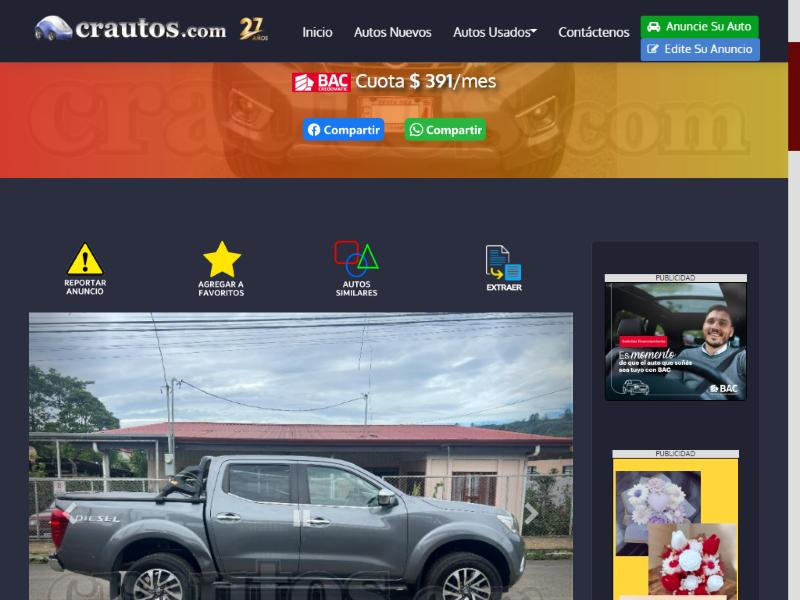

# 🐞 Reporte de Bug

## ID

BUG-008

## Título

Los íconos de acción de la ficha («Reportar», «Favoritos», «Autos similares», «Extraer») y `aiicon.png` son enlaces de imagen sin `alt` y sin nombre

## Estado

- [x] Nuevo
- [ ] En revisión
- [ ] En desarrollo
- [ ] Resuelto
- [ ] Cerrado

## Reportado por

Gabriel Isaías Fallas López

## Fecha de detección

2026-10-04

## Prioridad

- 🟠 **Alta** (afecta al usuario de forma notoria)

## Descripción

**Funcionalidad crítica (Tarea 2):** CT-02 — Detalle y galería del anuncio.

**Regla(s) de axe:** `image-alt`, `link-name`. **Criterio WCAG:** `image-alt`: 1.1.1 Contenido no textual (A); `link-name`: 2.4.4 Propósito de los enlaces (A) y 4.1.2 Nombre, función, valor (A).

Página(s) donde se observó:

- Ficha del anuncio: `https://crautos.com/autosusados/cardetail.cfm?c=20483869` (viewport 1280×800)

## Pasos para reproducir

1. Abrir `https://crautos.com/autosusados/cardetail.cfm?c=20483869` en Chromium con un viewport de 1280×800, sin iniciar sesión.
2. En la consola del navegador cargar axe-core 4.10.2 (`https://cdnjs.cloudflare.com/ajax/libs/axe-core/4.10.2/axe.min.js`) y ejecutar `await axe.run(document, {resultTypes: ['violations', 'incomplete']})` (equivale a «Scan all of my page» de Axe DevTools).
3. En `violations`, abrir la(s) regla(s) `link-name` y buscar los nodos con los selectores de la tabla de «Resultado obtenido».

## Resultado esperado

- El enlace tiene un nombre accesible que describa su acción (`alt` en la imagen o texto real).
- El enlace tiene un nombre accesible que describa su función.

## Resultado obtenido

- Axe reportó dos reglas sobre el mismo elemento: `link-name` (Serio, 2.4.4 y 4.1.2 (A); «Element is in tab order and does not have accessible text») e `image-alt` (Crítico, 1.1.1 (A); «Element does not have an alt attribute»).
- Axe reportó `link-name` (Serio, 2.4.4 y 4.1.2 (A)) e `image-alt` (Crítico, 1.1.1 (A)) sobre el mismo elemento.
- Elementos agrupados (el identificador anterior es el de la versión previa de los reportes, ver «Equivalencia de IDs» del README):

| Antes | Elemento | Selector | HTML devuelto por axe |
|---|---|---|---|
| ant-038 | El ícono «Reportar anuncio» de la ficha es un enlace de imagen sin `alt` y sin nombre | `img[src$="icon-reportad.png"]` | `` |
| ant-044 | La imagen-enlace `aiicon.png` de la ficha no tiene `alt` ni nombre | `a[href="javascript:toggleVisibility();"]` | `` |

## Evidencia

- Resultado crudo de axe: [`evidencia/axe/ficha.jsonl`](../evidencia/axe/ficha.jsonl) (buscar la regla indicada).
- Captura de la ficha: 

## Entorno de pruebas

- Navegador: Chromium 152 (navegador integrado de la app Claude para escritorio)
- Herramienta: axe-core 4.10.2 (motor de Axe DevTools)
- Dispositivo: Escritorio (viewport emulado 1280×800)
- Sistema operativo: Windows 11 Pro
- URL: `https://crautos.com/autosusados/cardetail.cfm?c=20483869`

## Notas adicionales

- Aparece en la ficha 20483869; no se verificó si aparece en todas las fichas.
- Reemplaza a los reportes individuales ant-038, ant-039, ant-040, ant-041, ant-044 de la versión anterior (113 reportes) (ver «Equivalencia de IDs» en el [README](../README.md#equivalencia-de-ids)). La prioridad del grupo es la más alta de sus elementos.
- Prioridad individual de los elementos: ant-038 Media; ant-039 Alta; ant-040 Media; ant-041 Media; ant-044 Media.

Referencias de las reglas de axe:

  - `image-alt`: https://dequeuniversity.com/rules/axe/4.10/image-alt
  - `link-name`: https://dequeuniversity.com/rules/axe/4.10/link-name
