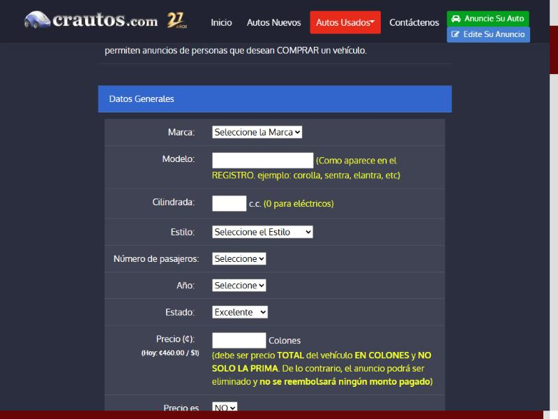

# 🐞 Reporte de Bug

## ID

BUG-008

## Título

Los grupos repetidos de radios y casillas de «Anuncie su auto» (km/millas, 39 de equipamiento, 38 de opciones de pago) no tienen etiqueta

## Estado

- [x] Nuevo
- [ ] En revisión
- [ ] En desarrollo
- [ ] Resuelto
- [ ] Cerrado

## Reportado por

Gabriel Isaías Fallas López

## Fecha de detección

2026-10-04

## Prioridad

- 🟠 **Alta** (afecta al usuario de forma notoria)

## Descripción

**Funcionalidad crítica (Tarea 2):** CT-04 — Publicación y edición de anuncios.

**Regla(s) de axe:** `label`. **Criterio WCAG:** `label`: 4.1.2 Nombre, función, valor (A).

Página(s) donde se observó:

- Anuncie su auto: `https://crautos.com/autosusados/anunciarse.cfm` (viewport 1280×800)

## Pasos para reproducir

1. Abrir `https://crautos.com/autosusados/anunciarse.cfm` en Chromium con un viewport de 1280×800, sin iniciar sesión.
2. En la consola del navegador cargar axe-core 4.10.2 (`https://cdnjs.cloudflare.com/ajax/libs/axe-core/4.10.2/axe.min.js`) y ejecutar `await axe.run(document, {resultTypes: ['violations', 'incomplete']})` (equivale a «Scan all of my page» de Axe DevTools).
3. En `violations`, abrir la(s) regla(s) `label` y buscar los nodos con los selectores de la tabla de «Resultado obtenido».
4. En la consola comprobar `document.querySelectorAll('label').length` y el texto visible que acompaña a cada control en la captura.

## Resultado esperado

- Cada control tiene un `<label for>` (o `aria-label`) con su nombre visible.

## Resultado obtenido

- Axe reportó la regla `label` (impacto Crítico, 4.1.2 Nombre, función, valor (A)) en «Anuncie su auto»: **95** nodo(s) en total.
- Mensaje de axe: «Element does not have an implicit (wrapped) <label> / Element does not have an explicit <label>».
- Elementos agrupados (el identificador anterior es el de la versión previa de los reportes, ver «Equivalencia de IDs» del README):

| Antes | Elemento | Selector | HTML devuelto por axe |
|---|---|---|---|
| ant-082 | Los botones de radio de kilometraje (km / millas) de «Anuncie su auto» no tienen etiqueta | `[name="mileagetype"]` | `<input type="radio" name="mileagetype" id="mileagetype" value="0" checked="">` |
| ant-083 | Las 39 casillas de equipamiento (`caracteristicas`) de «Anuncie su auto» no tienen etiqueta | `[name="caracteristicas"]` | `<input type="checkbox" name="caracteristicas" value="1"> (y las demás con value 2 … 39)` |
| ant-084 | Los 38 botones de radio de las opciones de pago («NO deseo / SI deseo esta opción») no tienen etiqueta | `[name="option1"]` | `<input name="option9" type="radio" value="0"> (y los demás radios 'option*')` |

- Inspección manual: `document.querySelectorAll('label').length` devolvió **0** en la página.

## Evidencia

- Resultado crudo de axe: [`evidencia/axe/publicar.jsonl`](../evidencia/axe/publicar.jsonl) (buscar la regla indicada).
- Captura del formulario (los rótulos se ven como texto junto al campo, pero no están asociados): 

## Entorno de pruebas

- Navegador: Chromium 152 (navegador integrado de la app Claude para escritorio)
- Herramienta: axe-core 4.10.2 (motor de Axe DevTools)
- Dispositivo: Escritorio (viewport emulado 1280×800)
- Sistema operativo: Windows 11 Pro
- URL: `https://crautos.com/autosusados/anunciarse.cfm`

## Notas adicionales

- El texto visible de cada opción (km / millas) no se leyó en la captura; el orden de las opciones se tomó del `value` (0 y 1).
- Además no hay `<fieldset>`/`<legend>` que agrupe las casillas (ver el bug de secciones sin encabezado).
- Contexto leído en la página: «NO deseo esta opción - ¢ 0 / SI deseo esta opción - ¢ 2,260». Son servicios opcionales con costo, por lo que elegir sin saber cuál es cada opción tiene consecuencias económicas.
- Inspección: `document.querySelectorAll('input[type=radio][name^=option]').length` devolvió 38.
- Reemplaza a los reportes individuales ant-082, ant-083, ant-084 de la versión anterior (113 reportes) (ver «Equivalencia de IDs» en el [README](../README.md#equivalencia-de-ids)). La prioridad del grupo es la más alta de sus elementos.

Referencias de las reglas de axe:

  - `label`: https://dequeuniversity.com/rules/axe/4.10/label
