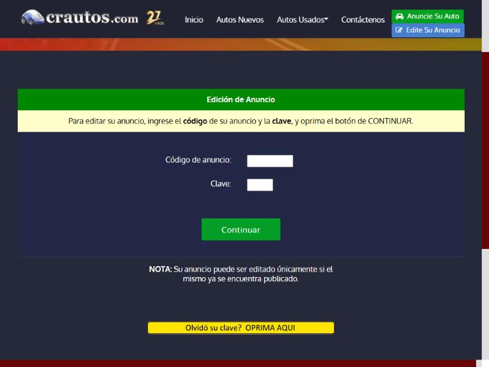
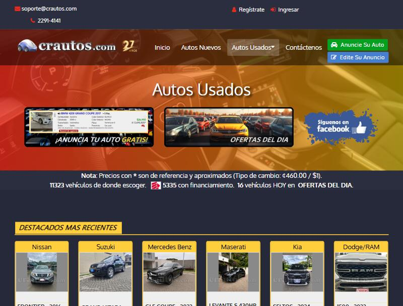

# 🐞 Reporte de Bug

## ID

BUG-011

## Título

Siete botones (BUSCAR, Comparar, Última Página, Continuar ×2, Anuncie Su Auto y Edite Su Anuncio) con texto blanco no alcanzan el contraste mínimo

## Estado

- [x] Nuevo
- [ ] En revisión
- [ ] En desarrollo
- [ ] Resuelto
- [ ] Cerrado

## Reportado por

Gabriel Isaías Fallas López

## Fecha de detección

2026-10-04

## Prioridad

- 🟡 **Media** (molesta, pero tiene solución temporal)

## Descripción

**Funcionalidad crítica (Tarea 2):** CT-01 — Búsqueda y listado de vehículos. / CT-04 — Publicación y edición de anuncios. / Todas (CT-01 a CT-04): elemento de la plantilla común.

**Regla(s) de axe:** `color-contrast`. **Criterio WCAG:** `color-contrast`: 1.4.3 Contraste mínimo (AA).

Página(s) donde se observó:

- Catálogo de Autos Usados: `https://crautos.com/autosusados/index.cfm` (viewport 1280×800 y 375×812)
- Resultados de búsqueda: `https://crautos.com/autosusados/searchresults.cfm?p=1&c=10040` (viewport 1280×800)
- Anuncie su auto: `https://crautos.com/autosusados/anunciarse.cfm` (viewport 1280×800)
- Editar anuncio: `https://crautos.com/anuncios/` (viewport 1280×800)
- Ficha del anuncio: `https://crautos.com/autosusados/cardetail.cfm?c=20483869` (viewport 1280×800)

## Pasos para reproducir

1. Abrir cada una de las páginas de la lista de arriba en Chromium con un viewport de 1280×800, sin iniciar sesión.
2. En la consola del navegador cargar axe-core 4.10.2 (`https://cdnjs.cloudflare.com/ajax/libs/axe-core/4.10.2/axe.min.js`) y ejecutar `await axe.run(document, {resultTypes: ['violations', 'incomplete']})` (equivale a «Scan all of my page» de Axe DevTools).
3. En `violations`, abrir la(s) regla(s) `color-contrast` y buscar los nodos con los selectores de la tabla de «Resultado obtenido».

## Resultado esperado

- El texto del botón alcanza al menos 4,5:1.

## Resultado obtenido

- Axe reportó `color-contrast` (impacto Serio, 1.4.3 Contraste mínimo (AA)) con estas mediciones:

| Elemento | Texto | Fondo | Tamaño | Contraste | Mínimo |
|---|---|---|---|---:|---:|
| Botón **BUSCAR** | #ffffff | #039e26 | 17,44 px (13,1 pt), normal | **3,54:1** | 4,5:1 |
| Botón **Comparar** (`.margin-10`) | #ffffff | #039e26 | 14 px (10,5 pt), normal | **3,54:1** | 4,5:1 |
| Botón **Última Página >>** (`.btn-xs`) | #ffffff | #039e26 | 14 px (10,5 pt), normal | **3,54:1** | 4,5:1 |
| Botón **Continuar** (`#submit`) | #ffffff | #039e26 | 17,44 px (13,1 pt), normal | **3,54:1** | 4,5:1 |
| Botón **Continuar** | #ffffff | #039e26 | 17,44 px (13,1 pt), normal | **3,54:1** | 4,5:1 |
| Botón del encabezado `.btn-sm.btn-green.ad-post` | #ffffff | #05a01f | 14 px (10,5 pt), normal | **3,46:1** | 4,5:1 |
| Botón del encabezado `.btn-sm.btn-blue.ad-post` | #ffffff | #467fcf | 14 px (10,5 pt), normal | **4,04:1** | 4,5:1 |

## Evidencia

- Resultado crudo de axe: [`evidencia/axe/catalogo.jsonl`](../evidencia/axe/catalogo.jsonl) (buscar la regla indicada).
- Resultado crudo de axe: [`evidencia/axe/catalogo-movil.jsonl`](../evidencia/axe/catalogo-movil.jsonl) (buscar la regla indicada). (también se reporta en la vista móvil).
- Resultado crudo de axe: [`evidencia/axe/resultados.jsonl`](../evidencia/axe/resultados.jsonl) (buscar la regla indicada).
- Resultado crudo de axe: [`evidencia/axe/publicar.jsonl`](../evidencia/axe/publicar.jsonl) (buscar la regla indicada). Además axe dejó 156 elementos de la página como `incomplete` (sin poder medir el contraste): se revisaron a mano (ver [`evidencia/revision-pendientes-axe.md`](../evidencia/revision-pendientes-axe.md)).
- Resultado crudo de axe: [`evidencia/axe/editar.jsonl`](../evidencia/axe/editar.jsonl) (buscar la regla indicada).
- Captura: 
- Resultado crudo de axe: [`evidencia/axe/ficha.jsonl`](../evidencia/axe/ficha.jsonl) (buscar la regla indicada).
- Captura (botones verde y azul en la esquina superior derecha): 

## Entorno de pruebas

- Navegador: Chromium 152 (navegador integrado de la app Claude para escritorio)
- Herramienta: axe-core 4.10.2 (motor de Axe DevTools)
- Dispositivo: Escritorio (viewport emulado 1280×800)
- Sistema operativo: Windows 11 Pro
- URL: `https://crautos.com/autosusados/index.cfm`, `https://crautos.com/autosusados/searchresults.cfm?p=1&c=10040`, `https://crautos.com/autosusados/anunciarse.cfm`, `https://crautos.com/anuncios/`, `https://crautos.com/autosusados/cardetail.cfm?c=20483869`

## Notas adicionales

- HTML: `<a class="btn btn-sm btn-green ad-post" href="/autosusados/anunciarse.cfm" ...>`. Axe reportó este mismo nodo en las 5 páginas analizadas.
- HTML: `<a class="btn btn-sm btn-blue ad-post" href="/anuncios"><i class="fa fa-edit text-white me-1"></i> Edite Su Anuncio</a>`. Axe reportó este mismo nodo en las 5 páginas analizadas.
- Reemplaza a los reportes individuales ant-030, ant-036, ant-037, ant-091, ant-099, ant-111, ant-112 de la versión anterior (113 reportes) (ver «Equivalencia de IDs» en el [README](../README.md#equivalencia-de-ids)). La prioridad del grupo es la más alta de sus elementos.

Referencias de las reglas de axe:

  - `color-contrast`: https://dequeuniversity.com/rules/axe/4.10/color-contrast
